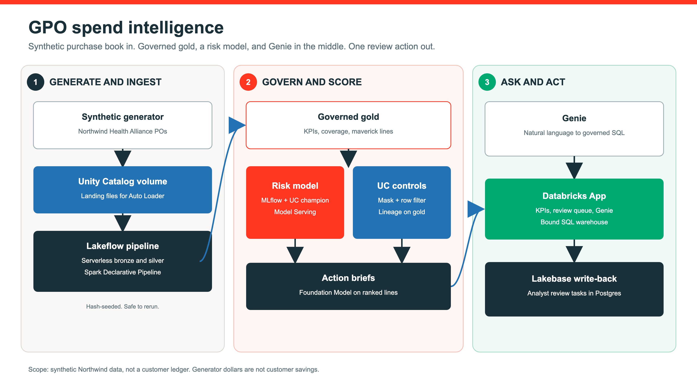

# GPO Spend Intelligence

Fork this repository, point it at your Databricks workspace, and deploy a GPO spend and contract-intelligence pattern on **synthetic** Northwind Health Alliance data. No customer data, customer KPIs, PHI, or credentials are included.

This README is the GitHub source of truth. `databricks bundle deploy` uploads jobs, the pipeline, notebooks, and the app. It does **not** publish this README or the architecture image into the workspace.

## What this proves

Member organizations leak value when they buy off contract. This bundle:

1. Generates a deterministic synthetic purchase book.
2. Ingests events through a serverless Spark Declarative Pipeline (bronze to silver).
3. Builds governed gold tables with Unity Catalog masks and row filters.
4. Trains a maverick-risk model, registers it in Unity Catalog, and deploys Model Serving.
5. Drafts action briefs with a Foundation Model.
6. Optionally binds a Databricks App to a SQL warehouse, a Genie space, and Lakebase for analyst write-back.

All dollar figures in the gold tables come from the generator. They are not a customer invoice and not a customer savings claim.

## Architecture



Editable source: [`docs/diagrams/gpo_spend_intelligence.svg`](docs/diagrams/gpo_spend_intelligence.svg).

## Use in your workspace

| Value | Where | Notes |
|---|---|---|
| Databricks CLI profile | `-p <profile>` after `databricks auth login` | Must match your workspace URL |
| `catalog` | `--var` | Catalog where you can create a schema |
| `schema` | optional `--var` | Default `gpo_spend_intelligence` |
| `warehouse_id` | required `--var` | SQL warehouse for the app and checks |
| `genie_space_id` | required `--var` for the app | Create the space from `resources/genie_space.serialized.json` first |
| `lakebase_project` | required `--var` for the app | Existing Lakebase project |
| `endpoint` | optional `--var` | Default `gpo-maverick-risk` |
| `llm_endpoint` | optional `--var` | Foundation Model for briefs |

```bash
git clone https://github.com/archana986/gpo-spend-intelligence.git
cd gpo-spend-intelligence

databricks auth login --host <your-workspace-url> -p <profile>

databricks bundle validate --strict -t dev -p <profile> \
  --var catalog=<catalog> \
  --var warehouse_id=<warehouse_id> \
  --var genie_space_id=<genie_space_id> \
  --var lakebase_project=<lakebase_project>

databricks bundle deploy -t dev -p <profile> \
  --var catalog=<catalog> \
  --var warehouse_id=<warehouse_id> \
  --var genie_space_id=<genie_space_id> \
  --var lakebase_project=<lakebase_project>

databricks bundle run gpo_build -t dev -p <profile> \
  --var catalog=<catalog> \
  --var warehouse_id=<warehouse_id> \
  --var genie_space_id=<genie_space_id> \
  --var lakebase_project=<lakebase_project>
```

The build job regenerates synthetic data, ingest, the model, governance, briefs, serving, and in-job validation. Runtime is dominated by Model Serving.

Optional app start:

```bash
databricks bundle run gpo_app -t dev -p <profile> \
  --var catalog=<catalog> \
  --var warehouse_id=<warehouse_id> \
  --var genie_space_id=<genie_space_id> \
  --var lakebase_project=<lakebase_project>
```

Grant the app service principal `USE CATALOG`, `USE SCHEMA`, and `SELECT` on `<catalog>.<schema>` plus `CAN_RUN` on the Genie space.

## Files

| Path | Use |
|---|---|
| `src/notebooks/` | Generate, train, govern, briefs, serving, validate |
| `src/pipelines/` | Spark Declarative Pipeline |
| `src/app/` | Databricks App |
| `src/tests/validate_build.py` | Optional independent checks after a successful job |
| `resources/` | Job, pipeline, app, Genie definition |
| `docs/diagrams/` | Architecture PNG and SVG |
| `SETUP.md` | Prerequisites, Genie and Lakebase prep, limitations, cleanup |

See `SETUP.md` for known limitations. Genie and Lakebase are external prerequisites. The generator is synthetic by design.
